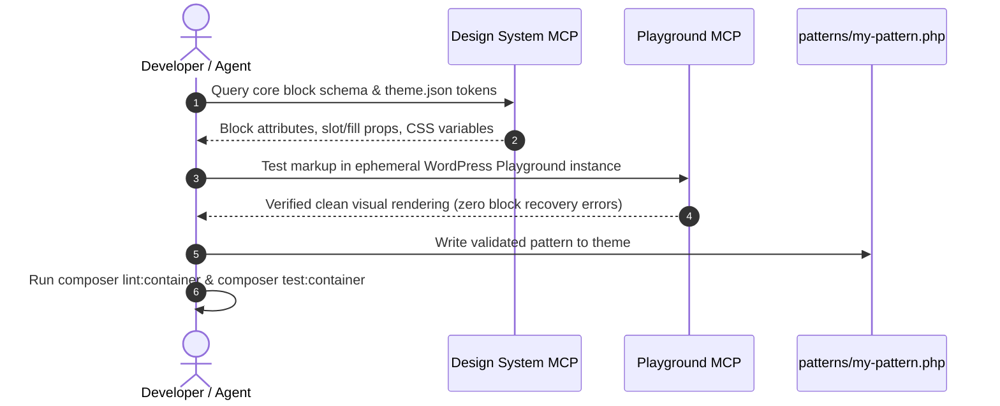

# WordPress Block & Pattern Development

This skill provides operational workflows and coding standards for authoring Full Site Editing (FSE) block patterns and templates in the active theme (`web/app/themes/twentytwentyfour/`).

---

## 1. Block Pattern Standards (`patterns/*.php`)

Modern block themes register layouts declaratively via PHP files placed in the theme's `patterns/` directory.

### Pattern File Header Template

Every pattern must begin with a standardized header docblock:

```php
<?php
/**
 * Title: Feature Callout Grid
 * Slug: twentytwentyfour/feature-callout-grid
 * Categories: featured, services
 * Keywords: features, services, cards, grid
 * Description: A responsive 3-column card grid highlighting key service offerings.
 * Inserter: true
 */

declare(strict_types=1);
?>
```

### Gutenberg Block Markup Rules

1. **Strict HTML Comment Delimiters**: Always ensure closing block comments match opening comments precisely (e.g., `<!-- wp:group -->` and `<!-- /wp:group -->`) to prevent "Attempt Block Recovery" warnings.
2. **Design Tokens Over Hardcoded Styles**:
   - Never use arbitrary inline CSS pixels (e.g., `style="padding: 24px"`).
   - Use `theme.json` preset variables:
     - Spacing: `var:preset|spacing|40`
     - Typography: `var:preset|font-size|large`
     - Color: `var:preset|color|base`, `var:preset|color|contrast`
3. **Semantic HTML Tags**: Configure containers with semantic HTML elements (`<header>`, `<section>`, `<article>`, `<footer>`) via the `tagName` block attribute.
4. **Internationalization (i18n)**: All user-facing text inside PHP pattern files must be wrapped in WordPress translation functions:
   ```php
   <?php echo esc_html__( 'Discover Our Platform', 'twentytwentyfour' ); ?>
   ```
5. **No Hardcoded URLs or IDs**: Use relative placeholders or dynamic template tags for links and images.

---

## 2. Agentic Pattern Development Lifecycle



---

## 3. Best Practices & Troubleshooting

* **Validating Patterns**:
  - Test the pattern in an isolated environment using `@wp-playground/mcp` or a local development container.
  - Insert the pattern into the Gutenberg block editor; verify that saving and reloading does not trigger block recovery.
* **Block Theme Token Editing (`theme.json`)**:
  - Keep theme modifications aligned with core Gutenberg schemas.
  - Check colors, gradients, font families, and spacing presets in `web/app/themes/twentytwentyfour/theme.json`.
